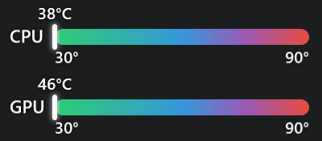
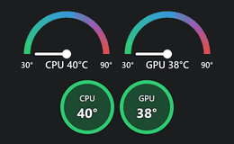

# TempBar

<p align="center">
  
</p>

Duas barras minimalistas que mostram a temperatura da **CPU** e da **GPU** sempre visíveis no topo da tela, sem janela, sem moldura e sem atrapalhar o que você está fazendo.

<p align="center">
  
</p>

### Layouts: velocímetro e círculo

<p align="center">
  
</p>

## Recursos

- Barra de gradiente (verde → azul → vermelho) com um marcador animado que acompanha a temperatura.
- Mínimo e máximo da escala nas pontas e o valor atual em °C acima do marcador.
- **Três layouts**: **barra**, **velocímetro** (semicírculo com degradê e ponteiro animado) e **círculo** (valor no centro, cor em degradê conforme a temperatura).
- Um indicador para CPU e outro para GPU, **empilhados** ou **lado a lado**, em qualquer layout.
- Janela sem borda, sempre no topo (inclusive sobre a barra de tarefas), arrastável e com opção de **bloquear a posição**.
- **Transparência ajustável** de 20% a 100% (nunca some por completo).
- **Minimizar para a bandeja** do sistema.
- Posição e preferências salvas automaticamente.

Tudo é controlado pelo menu do botão direito:

| Opção | O que faz |
|---|---|
| Bloquear / Desbloquear posição | Impede (ou permite) arrastar a barra |
| Layout | Barra, Velocímetro ou Círculo |
| Iniciar com o Windows | Liga/desliga o início automático (na última posição, bloqueada) |
| Transparência | Controle deslizante de 20% a 100% |
| Orientação | Vertical (empilhadas) ou horizontal (lado a lado) |
| Minimizar para a bandeja | Esconde a barra e deixa um ícone na bandeja |
| Sair | Fecha o aplicativo |

## Como usar

1. Baixe o `TempBar.exe` na aba **Releases** do repositório.
2. Execute. É um único arquivo e **não precisa instalar o .NET**.
3. Aceite o pedido de administrador (veja o motivo abaixo).

Requisitos: Windows 10 ou 11 de 64 bits.

### Por que pede administrador?

O Windows não tem uma API nativa para a temperatura real dos núcleos da CPU. O TempBar lê os sensores com a biblioteca [LibreHardwareMonitor](https://github.com/LibreHardwareMonitor/LibreHardwareMonitor), que usa um driver de kernel e por isso exige privilégios elevados. Sem administrador, a barra mostra `--`.

### Compatibilidade e dependências

O TempBar **não depende de nenhum software de fabricante** (MSI Center, Magic Light, Armoury Crate, Afterburner etc.). Ele lê os sensores diretamente pela LibreHardwareMonitor, que acessa o hardware por conta própria.

- **Necessário:** Windows 10/11 64 bits e execução como administrador.
- **CPU:** Intel e AMD, conforme suporte da LibreHardwareMonitor.
- **GPU:** NVIDIA, AMD e Intel, conforme suporte da LibreHardwareMonitor. Em NVIDIA a leitura usa o driver oficial da placa, então mantenha-o instalado.
- **Jogos:** a barra aparece sobre jogos em **janela sem borda** (*borderless*). Em **tela cheia exclusiva** nenhum overlay comum consegue aparecer por cima.

**Testado em:** AMD Ryzen 5 5500, NVIDIA GeForce RTX 3050, Windows 11 Pro. O MSI Center estava instalado nessa máquina, mas o código não o utiliza. Em outras combinações de hardware o comportamento não foi verificado. Se algum sensor não funcionar no seu PC, abra uma *issue* informando o modelo da CPU/GPU.

### Avisos conhecidos

- O executável não é assinado digitalmente, então o **Windows SmartScreen** pode avisar de "editor desconhecido". Use "Mais informações → Executar assim mesmo".
- Alguns antivírus sinalizam o driver de leitura de sensores usado pela LibreHardwareMonitor. É um falso positivo comum nesse tipo de ferramenta.
- Em alguns computadores a GPU integrada ou certos sensores não expõem temperatura. Nesse caso a barra correspondente mostra `--`.

## Configurações

As preferências ficam em `%AppData%\TempBar\settings.json`. Além do que o menu controla, é possível editar a escala das barras:

```json
{
  "MinTemp": 30,
  "MaxTemp": 90
}
```

## Compilar a partir do código

Requer o [SDK do .NET 10](https://dotnet.microsoft.com/download).

```powershell
# executar em desenvolvimento
dotnet run

# gerar o .exe único (sem dependências)
dotnet publish -c Release -r win-x64 --self-contained `
  -p:PublishSingleFile=true `
  -p:IncludeNativeLibrariesForSelfExtract=true `
  -p:EnableCompressionInSingleFile=true `
  -p:DebugType=None -o publish
```

## Estrutura

| Arquivo | Responsabilidade |
|---|---|
| `TemperatureReader.cs` | Lê CPU/GPU pela LibreHardwareMonitor e escolhe o sensor mais representativo |
| `TempGauge.xaml(.cs)` | Controle de uma barra: gradiente, rótulos, marcador animado |
| `TempDial.cs` / `TempCircle.cs` | Indicadores em velocímetro e em círculo |
| `TempVisuals.cs` | Interface comum, enum de layouts e cores do degradê |
| `MainWindow.xaml(.cs)` | Janela sem borda, menu, orientação, transparência, bandeja, manter no topo |
| `Settings.cs` | Persistência das preferências em `%AppData%` |

Tecnologias: C#, .NET 10, WPF, LibreHardwareMonitor.

## Licença e créditos

Distribuído sob a licença MIT (veja [LICENSE](LICENSE)).

Usa a [LibreHardwareMonitorLib](https://github.com/LibreHardwareMonitor/LibreHardwareMonitor), licenciada sob a MPL 2.0.
